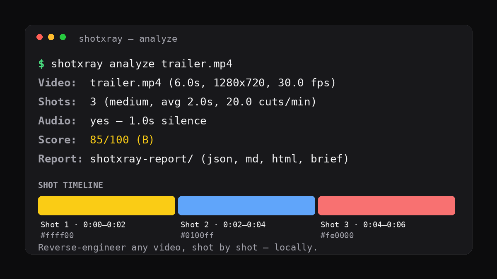

# shotxray — Reverse-engineer any video, shot by shot

[](https://www.python.org/)
[](LICENSE)
[](#how-it-works)
[](https://github.com/BidyutRoy2/shotxray/actions/workflows/ci.yml)

**Point shotxray at a video file and get a shot-by-shot X-ray: every cut, every colour, the pacing, the audio pauses — plus a rebuild brief that tells you exactly how to remake it. Locally. No cloud, no API key, no LLM.**



> **Why video?** The most-starred repos of the week study how software works and rebuild it (`rea`, `craft-anything`). Video is the same idea for the medium everyone actually watches: `rea-video` shot to the top of GitHub trending the day it appeared, because creators want to know *how a video was made*. shotxray answers that for any file on your disk — with ffmpeg doing the measuring and plain Python doing the reporting, nothing uploaded anywhere.

## What you get in 10 seconds

```bash
git clone https://github.com/BidyutRoy2/shotxray.git
cd shotxray
pip install -e .
shotxray analyze trailer.mp4
```

```
Video:  trailer.mp4 (6.0s, 1280x720, 30.0 fps)
Shots:  3 (medium, avg 2.0s, 20.0 cuts/min)
Audio:  yes — 1.0s silence
Score:  85/100 (B)
Report: shotxray-report/ (report.json, report.md, report.html, brief.md)
```

Open `shotxray-report/report.html` — a dark-mode-aware report with a colour-coded shot timeline, per-shot thumbnails and a score breakdown. Or open [`assets/preview.html`](assets/preview.html) to see a sample report right now, no video needed.

**Prerequisite:** `ffmpeg` and `ffprobe` on your PATH ([ffmpeg.org](https://ffmpeg.org/download.html) · macOS: `brew install ffmpeg` · Ubuntu/Debian: `sudo apt install ffmpeg` · Windows: `winget install ffmpeg`). shotxray itself has **zero Python dependencies** — stdlib only.

## How shotxray reverse-engineers a video

| Question | How it is measured | Where it lands |
|---|---|---|
| Where are the cuts? | ffmpeg `select` scene-change detection (luma change, tunable `--threshold`) | Shot list + timeline |
| What does each shot look like? | Mid-shot frame: dominant colour (1×1 pixel average) + brightness | Shot cards, palette |
| How fast does it cut? | Avg shot length, cuts/minute, shortest/longest shot | Pacing label: fast-cut / medium / slow / single-shot |
| What does the audio do? | `volumedetect` loudness + `silencedetect` pause map | Audio segments vs. silence |
| What do the captions say? | Embedded subtitle stream extracted as SRT (if present) | Caption cues + word count |
| How do I remake it? | Shot list + checklist generated from the measured values | `brief.md` rebuild brief |
| How complete is the picture? | Remake Readiness score 0–100 with a per-component breakdown | Every report |

**Honest limits, stated up front:** shotxray measures structure, not meaning. It does not transcribe speech, OCR on-screen text, or detect camera movement — the brief says so instead of guessing. Scene detection scores luma change, so a cut between two shots of near-identical brightness can be missed; lower `--threshold` (e.g. `0.2`) if you suspect one. See [docs/shot-detection.md](docs/shot-detection.md).

## Commands

```bash
# Full analysis: JSON + Markdown + HTML reports + rebuild brief + thumbnails
shotxray analyze video.mp4 -o my-report

# Just the shot boundaries (table or JSON)
shotxray shots video.mp4
shotxray shots video.mp4 --json

# Just the rebuild brief, printed to stdout
shotxray brief video.mp4
shotxray brief video.mp4 -o brief.md

# Just the audio profile: loudness + silence map
shotxray audio video.mp4
shotxray audio video.mp4 --json

# Tune sensitivity: lower threshold = more (shorter) shots detected
shotxray analyze video.mp4 --threshold 0.2
```

## The rebuild brief

`brief.md` is the point of the tool: a shot-by-shot remake guide grounded in measured values, not vibes.

```markdown
## Shot list — recreate in order

| # | Start | Length | Colour | Light | How to remake it |
|---|-------|--------|--------|-------|------------------|
| 1 | 0:00.00 | 2.0s | #ffff00 | very bright | Hold one static wide 16:9 frame for 2.0s ... Cut hard at 0:02.00 |
| 2 | 0:02.00 | 2.0s | #0100ff | very dark | Hold one static wide 16:9 frame for 2.0s ... Cut hard at 0:04.00 |
```

It also includes a remake checklist (hook first, cut times, target pacing, audio beats) and a section on what shotxray *cannot* tell you — so you know exactly where the measurement ends and your judgement begins.

## Remake Readiness score

A completeness score (0–100), not a quality judgement. A brilliant video with no embedded captions loses the 15 caption points — the report names the missing points.

| Component | Points | What earns them |
|---|---|---|
| Metadata | 25 | duration, resolution, fps, codec all readable |
| Shot detection | 25 | ≥1 shot with clean boundaries |
| Per-shot visuals | 20 | thumbnail + colour + brightness for every shot |
| Audio profile | 15 | audio present (8) + silence map (7) |
| Captions | 15 | embedded caption cues found |

Grades: A ≥90 · B ≥75 · C ≥60 · D ≥40 · F <40.

## shotxray vs. the alternatives

| Tool | What it does | Needs | Cost |
|---|---|---|---|
| **shotxray** | Local shot-by-shot analysis + rebuild brief | ffmpeg only | Free, offline |
| rea-video | AI reverse-engineers videos shot by shot | Model/API access | Varies |
| craft-anything / rea | Study + rebuild *software* | Agent + tools | Varies |
| Manual ffprobe + ffmpeg | Same raw data, assembled by hand | Your time | Free, slow |
| Cloud video-intelligence APIs | Shot detection as a service | Upload + API key + billing | Paid per minute |

shotxray is the small, boring, dependable option: it runs on your machine, on your files, and tells you when it doesn't know something.

## Use it with a coding agent

shotxray ships a `SKILL.md` ([skills/shotxray/SKILL.md](skills/shotxray/SKILL.md)) so Claude Code / Codex-style agents can analyse a video and hand you the brief. The JSON report (`report.json`) is the machine-readable contract: shot list, pacing, audio, captions, score.

```bash
# Example: analyse every video in a folder, then let your agent summarise
for f in clips/*.mp4; do shotxray analyze "$f" -o "reports/$(basename "$f" .mp4)"; done
```

## Examples

`examples/` ships a 6-second sample video (three colour scenes + a deliberate 1s audio gap) and the exact reports shotxray produces for it:

- [`examples/sample-video.mp4`](examples/sample-video.mp4) — try it: `shotxray analyze examples/sample-video.mp4`
- [`examples/sample-report.md`](examples/sample-report.md) · [`examples/sample-report.json`](examples/sample-report.json) · [`examples/sample-brief.md`](examples/sample-brief.md)

## FAQ — video reverse engineering, shot detection, rebuild briefs

**What is shot detection?** Splitting a video at its cuts. shotxray uses ffmpeg's scene-change score: any frame that differs enough from the previous one starts a new shot.

**Do I need an API key or an account?** No. Everything runs locally; the only network use is cloning the repo.

**Does it upload my video anywhere?** No. ffprobe/ffmpeg read the file on your disk. There is no network code in shotxray at all.

**Can it analyse a YouTube video?** Not directly — download the file first (e.g. with `yt-dlp`), then run shotxray on it. Respect the creator's rights and the platform's terms.

**What formats work?** Anything ffmpeg reads: mp4, mov, mkv, webm, avi, m4v, flv, wmv, mpg, 3gp, ts.

**Why is my video one single shot?** Either it really is one continuous shot, or the cuts are between similarly-bright scenes (luma-based detection). Try `--threshold 0.2` or `0.15`.

**Can it transcribe speech?** No — that needs a speech model, which is out of scope for a zero-dependency local tool. If the file has embedded captions, those are extracted instead.

**Does it work on long videos?** Yes. Scene detection is a single ffmpeg pass; a 10-minute video analyses in seconds on a normal laptop. Thumbnails are one frame per shot.

## Contributing

See [CONTRIBUTING.md](CONTRIBUTING.md). Bug reports and feature requests go through GitHub Issues — the templates are in `.github/ISSUE_TEMPLATE/`.

## License

MIT — see [LICENSE](LICENSE).
